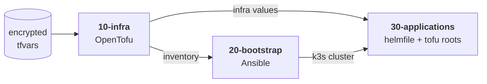
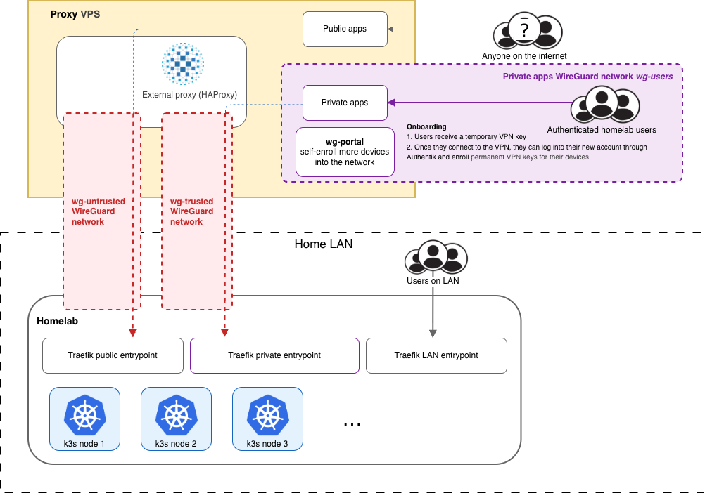

# Homelab

This repository holds my Homelab setup. It's mostly composed of [OpenTofu](https://opentofu.org), [Ansible](https://docs.ansible.com), [Helm](https://helm.sh) amongst other things. I probably went a bit overboard with automation as I made sure I can go from nothing to VMs, networking, DNS, a [k3s](https://k3s.io) cluster, and the applications on it with a single `task` command. My homelab mostly serves as a playground for me to learn and experiment with new toys. This is my first experience with kubernetes so you might find a lot of things that are not best practice.

There are some rules I try to stick to. The setup is rebuildable from scratch: a fresh clone plus one [age](https://github.com/FiloSottile/age) key is enough, since inputs, secrets and tofu state(s) are committed encrypted. Every hostname, address and credential lives in one encrypted tfvars set, and stages talk to each other only through files generated from it. High availability on the LAN is done with floating VIPs, such that any node can die without disruption, and remote access and proxying is done with a VPS and multiple Wireguard tunnels.

## The pipeline

The numbered directories are the deploy order and `task stages` walks them; each stage produces values that the next stage consumes. The stages are:

- [`10-infra`](10-infra/README.md) turns tfvars into Proxmox VMs, network bridges, remote VPS, WireGuard addressing, S3 buckets and Ansible inventory.
- [`20-bootstrap`](20-bootstrap/README.md) configures the VMs and the VPS: the k3s cluster, DNS, floating VIPs for HA, WireGuard tunnels and firewalls.
- [`30-applications`](30-applications/README.md) deploys storage, certificates, ingress, identity and the apps behind them, plus the HAProxy and wg-portal stacks on the VPS.

Each stage has its own README going deeper into its design.

## Remote access

Nothing at home is exposed to the internet. A small VPS with a public address runs [HAProxy](https://www.haproxy.org) and [wg-portal](https://github.com/h44z/wg-portal), and the homelab dials out to it over three [WireGuard](https://www.wireguard.com) networks:

- `wg-users`: the VPN people connect to. Users log in with their Authentik account and enroll their own devices through wg-portal.
- `wg-trusted`: VPS to homelab, carries the VPN users' traffic.
- `wg-untrusted`: VPS to homelab, carries traffic from the open internet.

Each network ends at its own Traefik entrypoint, so an app is reachable from the internet, the VPN or the LAN simply by which traefik entrypoints its routes are attached to.

## Working in the repo

This repo ships a [devbox](https://www.jetify.com/devbox) environment for all tools used in the pipeline (see [devbox.json](devbox.json)). When working, always activate the devbox shell by running `devbox shell`.

### Secrets

Secrets (and anything else I'd rather not have sitting in cleartext on a public repo) are encrypted with [SOPS](https://github.com/getsops/sops) and committed. Every file with `.enc` in its name is SOPS-encrypted. k3s Secrets use `.k3ssecret.enc`: instead of being fully encrypted, they keep their metadata in cleartext.

The workflow:

1. Supply the SOPS key in [`.sops/keys.txt`](.sops/keys.txt)
1. `devbox shell`
1. `task sops-open` to decrypt secrets in place
1. do dev/deploy/whatever
1. `task sops-stage` to stage the encrypted secrets for commit

A pre-commit hook (installed automatically by the devbox shell) checks that no unencrypted secrets are staged for commit.

### Deploying

I use [Taskfile](https://taskfile.dev) for deploying stuff. I will probably move to GitOps sometime in the future. The numbered directories are the pipeline, and `task stages` goes through them in order. Each stage, and each app under `30-applications` has its own Taskfile, such that each component can be deployed independently along with its dependencies.
